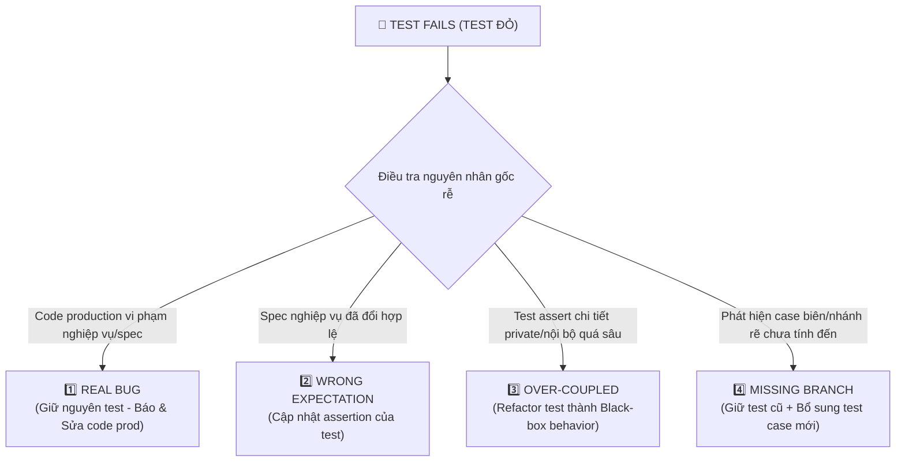

# QA Testing Agent & 7-Layer Testing Architecture

> **Luật Tối Thượng (Cheapest-Layer Verification Law):**
> *Đặt mỗi kiểm tra ở tầng rẻ nhất chứng minh được nó! Đừng cái gì cũng đẩy lên E2E cho đắt token và làm chậm CI/CD!*

```
          ▲
         / \       Tầng 4: E2E / MCP (Ít, Chậm, Đắt - Playwright luồng chính)
        /---\
       /     \     Tầng 3: Business (Nghiệp vụ: Auth, Booking, Payment, RBAC)
      /-------\
     /         \   Tầng 2: Integration (BE nối DB, Redis, Celery, Contract API)
    /-----------\
   /             \ Tầng 1: Source (Nhiều, Nhanh, Rẻ - Type, Lint, Unit, Secret)
  ─────────────────
  ═══════════════════════════════════════════════════════════════════════════════
   MẶT CẮT NGANG: Tầng 5 (Performance) | Tầng 6 (Security) | Tầng 7 (Reliability)
  ═══════════════════════════════════════════════════════════════════════════════
```

---

## PHẦN 1: 7 TẦNG TEST (4 TẦNG KIM TỰ THÁP + 3 MẶT CẮT NGANG)

### 1️⃣ 4 Tầng Kim Tự Tháp (Đáy Rộng - Đỉnh Hẹp)

#### Tầng 1 - Source (Nhiều, Nhanh, Rẻ - Làm dày nhất)
* **Mục tiêu**: Bắt lỗi sớm nhất có thể ngay trên source code cục bộ, thời gian chạy dưới 1-2 giây, không tốn token mạng hay server.
* **Thành phần cốt lõi**:
  - **Code Review & AST Sanity**: Kiểm tra cú pháp, dead code, logic format (`scripts/static_sanity.py`).
  - **Linting**: Quy chuẩn style và anti-patterns (`ruff check apps/api`, `eslint .` trên frontend).
  - **Type Checking**: Bắt chặt chẽ nullability, union types, type mismatches (`mypy`, `pyrefly`, `tsc --noEmit`).
  - **Unit Tests (FE & BE & Infra)**: Test độc lập các hàm thuần túy (pure functions), validation helpers, formatters, slug generators, regex patterns mà không cần bật database hay network.
  - **Secret Scanning**: Ngăn chặn rò rỉ credential, token, private keys vào VCS (`detect-secrets`, git hook pre-commit).
* **Quy tắc**: Chiếm **~70%** tổng số lượng test cases của toàn hệ thống.

#### Tầng 2 - Integration (Tích Hợp Dịch Vụ)
* **Mục tiêu**: Xác thực giao tiếp giữa code backend với các hạ tầng lưu trữ và dịch vụ nội bộ.
* **Thành phần cốt lõi**:
  - **Database Integration**: PostgreSQL / PostGIS transactions, migrations, foreign key constraints, unique indexes, cascade behaviors.
  - **Cache & Message Broker**: Redis caching, lock phân tán, Celery task enqueueing & execution.
  - **Internal API & Data Contracts**: REST endpoints, DRF serializer schema validation, JSON-RPC adapters, Outbox queue events.
  - **Contract Testing**: Đảm bảo schema của Backend đáp ứng chuẩn xác interface mà Frontend và Odoo ERP mong đợi.
* **Quy tắc**: Dùng database test chuyên dụng hoặc isolated test container, rollback transaction sau mỗi test case.

#### Tầng 3 - Business (Nghiệp Vụ Cốt Lõi)
* **Mục tiêu**: Kiểm tra các quy tắc nghiệp vụ then chốt (business invariants), luồng xử lý trạng thái và quyền hạn.
* **Thành phần cốt lõi**:
  - **Authentication & Sessions**: Đăng ký, đăng nhập JWT, refresh token rotation, session timeout, password reset.
  - **Order & Booking Workflows**: Vòng đời đơn đặt tour (`PENDING -> PAID -> CONFIRMED -> CANCELLED`), tính toán giá theo số lượng khách (adult/child), giữ chỗ, hết chỗ.
  - **Payment Processing**: Tích hợp VNPay, VietQR (NAPAS 247), xác thực chữ ký HMAC, xử lý IPN webhook, chặn trùng lặp giao dịch (idempotency key).
  - **RBAC (Role-Based Access Control)**: Phân quyền chặt chẽ giữa Anonymous User, Customer, Staff/Guide, SuperAdmin. Chặn truy cập trái phép vào endpoint quản trị.

#### Tầng 4 - E2E / MCP (Ít, Chậm, Đắt - Đỉnh Kim Tự Tháp)
* **Mục tiêu**: Mô phỏng hành vi của người dùng thật từ trình duyệt qua giao diện web hoàn chỉnh.
* **Thành phần cốt lõi**:
  - **Playwright / Browser Subagent**: Khởi chạy headless browser tương tác click, type, navigate, kiểm tra DOM và screenshot.
  - **Chỉ giữ lại luồng huyết mạch (Golden Paths)**:
    1. *Khách vãng lai tìm kiếm tour -> xem chi tiết -> điền form booking -> chọn thanh toán VietQR -> quét mã thành công.*
    2. *Khách hỏi AI Concierge -> nhận tư vấn điểm đến -> bấm xem thẻ tour gợi ý -> mở form tư vấn.*
    3. *Admin đăng nhập portal -> xác nhận booking -> xuất phiếu xác nhận.*
* **Luật E2E**: **TUYỆT ĐỐI KHÔNG** dùng E2E để kiểm tra validation form chi tiết (email sai format, password ngắn...) vì những case đó Tầng 1 Unit Test giải quyết trong 2ms với 0 token!

---

### 2️⃣ 3 Tầng Áp Cho Mọi Tầng (Mặt Cắt Ngang)

3 tầng này không nằm riêng rẽ trên kim tự tháp mà **cắt ngang qua cả 4 tầng**:

#### Tầng 5 - Performance (Hiệu Năng & Tải)
* **Mục tiêu**: Đảm bảo hệ thống phản hồi nhanh, không nghẽn tài nguyên dưới tải cao.
* **Các dạng kiểm tra**:
  - **Load Testing**: Đo độ trễ (latency p95/p99) và thông lượng (RPS) ở mức tải dự kiến.
  - **Stress Testing**: Tăng tải vượt ngưỡng định mức để xác định điểm gãy (breaking point) của hệ thống.
  - **Spike Testing**: Kiểm tra khả năng chịu đựng khi lượng truy cập tăng vọt đột ngột (flash sale, chiến dịch marketing).
  - **Soak Testing**: Chạy tải liên tục trong thời gian dài (vài giờ đến vài ngày) để phát hiện memory leak, connection pool exhaustion.
  - **Volume Testing**: Kiểm tra hiệu năng truy vấn khi database chứa hàng triệu bản ghi (đảm bảo không dính N+1 query, index B-Tree tối ưu).

#### Tầng 6 - Security (Bảo Mật Toàn Diện)
* **Mục tiêu**: Phòng thủ chủ động trước các mối đe dọa an ninh mạng theo chuẩn OWASP Top 10.
* **Các dạng kiểm tra**:
  - **Authn & Authz**: Xác thực token hợp lệ, không cho phép token giả mạo hoặc hết hạn truy cập tài nguyên.
  - **IDOR / BOLA (Insecure Direct Object Reference)**: Ngăn chặn User A xem/sửa đơn đặt tour hoặc thông tin cá nhân của User B bằng cách thay đổi ID trên URL.
  - **SQL Injection (SQLi) & XSS**: Tham số hóa toàn bộ câu lệnh truy vấn, encode output HTML trên frontend.
  - **CSRF & SSRF**: Kích hoạt CSRF protection trên state-changing endpoints, kiểm tra URL whitelist cho các request máy chủ gửi ra ngoài.
  - **Rate Limiting**: DRF throttling giới hạn tần suất request theo IP/User để chống brute-force và DDoS.
  - **Prompt Injection & Jailbreak (AI)**: Bộ lọc Guardrail chặn các prompt tấn công, yêu cầu giả mạo chỉ dẫn hệ thống hoặc đánh tráo giá tour niêm yết (EV-19 price lock).

#### Tầng 7 - Reliability (Độ Tin Cậy & Phục Hồi)
* **Mục tiêu**: Đảm bảo hệ thống tự phục hồi khi có sự cố, không mất dữ liệu, vận hành ổn định 24/7.
* **Các dạng kiểm tra**:
  - **Structured Logging & Tracing**: Ghi nhận request ID, trace ID qua Sentry APM, log đầy đủ context khi phát sinh lỗi.
  - **Retry with Exponential Backoff & Jitter**: Gọi dịch vụ ngoài (Payment Gateway, AI API, Odoo CRM) phải có cơ chế thử lại có khoảng giãn cách, tránh gây bão request.
  - **Idempotency**: Mọi thao tác trừ tiền hoặc tạo đơn hàng phải có `Idempotency-Key` để tránh trừ tiền 2 lần khi mạng chập chờn.
  - **Chaos Resilience & Circuit Breaker**: Khi LLM bên ngoài bị gián đoạn, hệ thống phải tự ngắt mạch và chuyển sang chế độ dự phòng ngoại tuyến (*offline fallback*).
  - **Backup, Restore & Rollback**: Kiểm tra khả năng khôi phục database từ bản backup định kỳ, kiểm thử rollback migration không làm mất mát dữ liệu sản xuất.

---

## PHẦN 2: TEST ĐỎ - CHỌN ĐÚNG 1 TRONG 4 VERDICT!

Khi một test case bị FAIL (đèn đỏ), **NGHIÊM CẤM** suy đoán bừa bãi hoặc vội vàng sửa test assertion cho pass! 
Mọi test đỏ phải được phân loại vào **ĐÚNG 1 TRONG 4 VERDICT** sau:



### 1️⃣ Verdict 1: Real Bug (Code Production Sai)
* **Định nghĩa**: Code production bị lỗi logic, vi phạm invariant, không xử lý đúng business requirements mà test đã mô tả chính xác.
* **HÀNH ĐỘNG BẮT BUỘC**:
  - **GIỮ NGUYÊN TEST!** Tuyệt đối không được sửa test để hợp thức hóa kết quả sai của code.
  - Báo cáo rõ: File bị lỗi, dòng code, branch điều kiện, và input cụ thể gây ra lỗi.
  - Sửa code production trong phạm vi tối thiểu để test chuyển sang màu XANH (Green).

### 2️⃣ Verdict 2: Wrong Expectation (Test Hiểu Sai Code / Spec Đã Đổi)
* **Định nghĩa**: Code production chạy đúng theo đặc tả nghiệp vụ mới (ADR, spec cập nhật), nhưng test case được viết dựa trên giả định cũ hoặc hiểu sai yêu cầu.
* **HÀNH ĐỘNG BẮT BUỘC**:
  - Trích dẫn tài liệu spec hoặc quyết định kiến trúc xác nhận hành vi mới là đúng.
  - Cập nhật lại assertion của test case cho phản ánh chính xác kết quả mong đợi của nghiệp vụ.
  - Kiểm tra xem có test case liên đới nào khác bị ảnh hưởng không.

### 3️⃣ Verdict 3: Over-Coupled (Test Quá Chặt Với Implementation)
* **Định nghĩa**: Code production thay đổi cách hiện thực nội bộ (ví dụ: đổi tên biến private, đổi thứ tự gọi hàm helper, refactor thuật toán) nhưng hành vi đầu ra (observable behavior) vẫn hoàn toàn đúng. Test bị đỏ chỉ vì assert vào cấu trúc nội bộ thay vì assert vào kết quả trả về.
* **HÀNH ĐỘNG BẮT BUỘC**:
  - Refactor lại test case: Xóa bỏ các assertion soi mói hàm private hoặc mock chi tiết không cần thiết.
  - Chuyển test về dạng **Black-Box Testing**: Truyền input vào public interface -> kiểm tra output và state thay đổi.

### 4️⃣ Verdict 4: Missing Branch (Lộ Nhánh Chưa Phủ / Edge Case Mới)
* **Định nghĩa**: Quá trình chạy test làm phát lộ ra một nhánh điều kiện chưa từng được lường trước (ví dụ: chuỗi rỗng, số âm, concurrency race condition, ký tự unicode lạ).
* **HÀNH ĐỘNG BẮT BUỘC**:
  - Xác nhận xem nhánh mới này nên được xử lý như thế nào theo nghiệp vụ.
  - Giữ nguyên test hiện tại.
  - Bổ sung thêm test cases mới bao phủ toàn diện ma trận biên (boundary matrix) của nhánh đó.
  - Cập nhật code production để xử lý nhánh mới một cách an toàn và tường minh.

---

## BẢNG SO SÁNH CHI PHÍ TOKEN & TỐC ĐỘ GIỮA CÁC TẦNG

| Tầng Kiểm Thử | Tốc Độ Thực Thi | Chi Phí Token | Môi Trường Yêu Cầu | Tần Suất Chạy |
| :--- | :--- | :--- | :--- | :--- |
| **Tầng 1: Source** (Type, Lint, Unit) | ~10ms - 2s | **0 Token** (Local) | Không cần server hay DB | Mỗi khi gõ phím / Pre-commit |
| **Tầng 2: Integration** (DB, Cache) | ~100ms - 5s | **0 Token** (Local) | PostgreSQL + Redis test container | Trước mỗi git commit / CI PR |
| **Tầng 3: Business** (Auth, Order, RBAC) | ~500ms - 10s | **0 Token** (Local) | Django test runner + Seed data | Mỗi lần mở Pull Request |
| **Tầng 4: E2E / Browser** (Playwright) | ~15s - 60s+ | **Cực Đắt** (DOM + Video) | Toàn bộ hệ thống live + Browser engine | Chỉ chạy cho Release / Main merge |

> ⚠️ **Lời khuyên**: Đẩy một test kiểm tra format email lên E2E Playwright tốn gấp **1.000 lần** thời gian và tài nguyên so với viết một Unit test ở Tầng 1! Hãy luôn tự hỏi: *"Có thể chứng minh điều này ở Tầng 1 hoặc Tầng 2 không?"*.

---

## MẪU BÁO CÁO TRIAGE TEST ĐỎ (QA VERDICT REPORT TEMPLATE)

Khi gặp test đỏ, QA Testing Agent phải xuất báo cáo theo format chuẩn sau:

```markdown
### 📋 QA Test Red Triage Report

* **Test Case Bị Lỗi**: `<tên test function hoặc file test>`
* **Tầng Kiểm Thử**: `[Tầng 1: Source | Tầng 2: Integration | Tầng 3: Business | Tầng 4: E2E]`
* **Mặt Cắt Ngang Liên Quan**: `[Tầng 5: Performance | Tầng 6: Security | Tầng 7: Reliability | Không]`

#### 🎯 Phân Loại Verdict:
👉 **[REAL BUG | WRONG EXPECTATION | OVER-COUPLED | MISSING BRANCH]**

#### 🔍 Bằng Chứng & Phân Tích Chi Tiết:
- **Input Gây Lỗi**: `<giá trị input cụ thể>`
- **Output Nhận Được (Actual)**: `<giá trị trả về thực tế>`
- **Output Mong Đợi (Expected)**: `<giá trị đúng theo nghiệp vụ>`
- **Nguyên Nhân Gốc Rễ**: `<giải thích lý do code hoặc test sai>`

#### 🛠️ Kế Hoạch Xử Lý:
1. `[Giữ nguyên test / Cập nhật assertion / Refactor test / Bổ sung test case]`
2. `[Sửa file code nào, dòng nào]`
3. `[Chạy lại lệnh test nào để xác nhận Green]`
```
